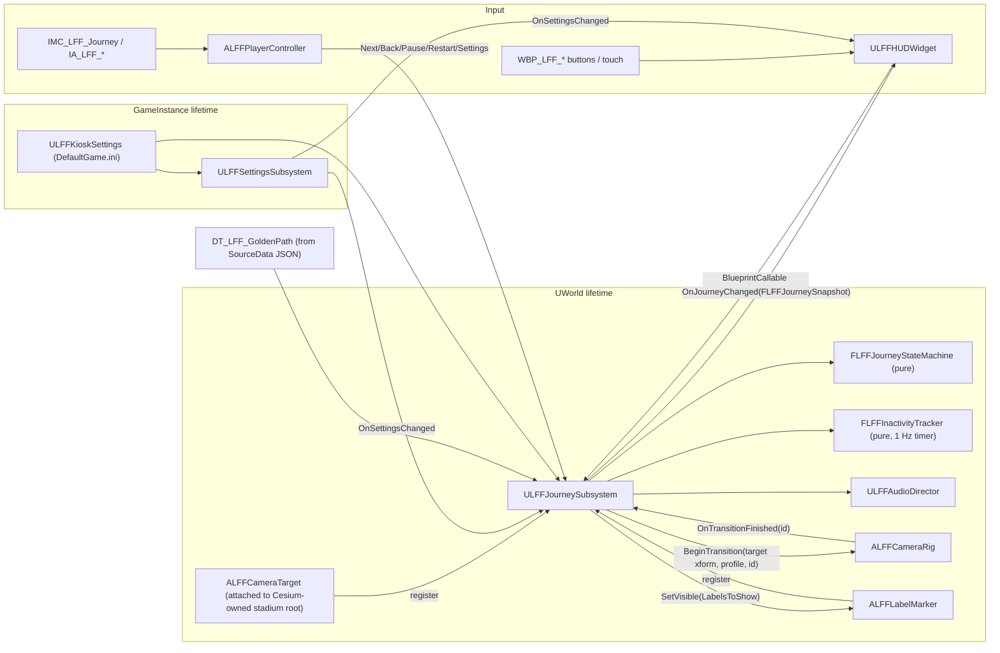

# ADR-0002: Journey runtime architecture (state, data, camera, input, UI)

- **Status:** Proposed
- **Date:** 2026-09-28
- **Scope:** The guided "game-day schedule" journey: step state, step data, camera transitions, input, settings, kiosk reset, UI, tests. Geo placement (Cesium georeference, stadium anchor, tiles) is **out of scope**. The Cesium agent owns it (LEDGER D1).
- **Companion:** `Docs/JOURNEY_SCHEMA.md` (class list, field lists, assets, input table, implementation order).
- **Verification:** Everything here was reasoned from the repo and from web-search snippets. None of it has been compiled (LEDGER F13, F14). Items marked **VERIFY** need a check against a UE 5.8 install.

## Context

Findings from inspecting the code (LEDGER F4–F9):

1. `AStadiumTourCamera` is a god object. It owns the step index, legacy input binding, widget creation, marker spawning and a Tick-driven lerp in one `ACameraActor`, so none of it can be tested without a map.
2. `FStadiumScheduleStop` stores raw `WorldLocation`/`CameraRotation`. These break when the georeference or stadium anchor moves (R4).
3. `NextStop`/`PreviousStop` wrap with `% StopCount` (F6, R8).
4. The scaffold has no Pause, Settings, reduced motion, sound toggle, disclaimer or inactivity reset (F7, R5).
5. Input uses legacy `ActionMappings` (F8). Restart is bound to `Gamepad_FaceButton_Bottom`, which is the gamepad's primary confirm button, so a single accidental press restarts the tour.
6. `ScheduleStops.template.json` is copied by hand into a Data Asset, so the two can drift (F9).
7. `UStadiumTourWidget` exposes `BlueprintPure` getters meant for UMG property bindings. Those bindings are evaluated every frame.
8. There are no `.uasset` files yet (F1). **Renaming C++ classes costs nothing now:** there are no redirects to add and no Blueprints to fix up.

Audience constraints: autistic and neurodivergent visitors, a public kiosk, and one large display with touch, mouse, keyboard and gamepad. The experience must be predictable, never move without the visitor asking, be easy to stop, have no surprise sound, and return calmly to the start for the next visitor.

## Decision

**D1: Split state three ways. Pure C++ logic, a World Subsystem for orchestration, a GameInstance Subsystem for settings.**
- `FLFFJourneyStateMachine` is a **plain C++ struct** with no UObject, world or time. It holds steps, index, phase, pause and a transition serial number. Commands return `ELFFCommandResult`. It is deterministic and unit-testable with no map.
- `ULFFJourneySubsystem : UWorldSubsystem` owns the state machine. It resolves named camera targets, drives `ALFFCameraRig`, runs the inactivity timer, owns `ULFFAudioDirector` and broadcasts one `FLFFJourneySnapshot` to UI. Its lifetime matches the world, which owns the rig, targets and timers, so nothing dangles across map loads. It is restricted to Game and PIE worlds via `DoesSupportWorldType`. The web-search snippet reports the signature `virtual bool DoesSupportWorldType(const EWorldType::Type) const`, but it hasn't been checked against a 5.8 install (**VERIFY**).
- `ULFFSettingsSubsystem : UGameInstanceSubsystem` holds the current visitor's `FLFFVisitorSettings`. The settings are world-independent and survive a map reload.
- No placed "manager" actor and no Level Blueprint logic.

**D2: Author steps in a Data Table (`DT_LFF_GoldenPath`, row struct `FLFFJourneyStep`), imported from a JSON source of truth in git.**
- The source file is `SourceData/Journey/LFF_GoldenPath.json`. It lives outside `Content/` so the editor doesn't auto-import it.
- `UDataTable` imports and reimports JSON natively, so no custom import tool is needed. It supports `ImportKeyField`, which lets `StepId` serve as the row name. Web search confirms the property exists; its 5.8 behaviour is **VERIFY**.
- Copy reviewers (Foundation, advisors, legal) can review the plain-language text as a JSON diff in a PR.
- Step order is the row order. An Automation test fails if the JSON and the cooked table disagree, which fixes F9.
- The existing struct already derives `FTableRowBase`. `UStadiumScheduleDataAsset` is deleted.

**D3: Steps reference a named `CameraTargetId`. They never store coordinates.**
- `ALFFCameraTarget` actors (each with an `FName TargetId`) are placed in the map, **attached under the stadium root actor that the Cesium agent owns**. Proposed tag: `LFF_SiteRoot`.
- Target and camera-rig actors register with the subsystem in `BeginPlay`.
- The rig reads the target's *current* world transform when a transition starts, and reads it again when the transition ends.
- If the Cesium agent re-anchors the stadium, the targets move with it. Journey code and data hold no ECEF, LLH or world positions.

**D4: Camera transitions are runtime-driven in V1. Sequencer is reserved for optional authored cinematics later (not in V1 scope).**
- There are three profiles: `Instant` (cut), `Ease` (ease-in-out lerp and slerp, roll forced to 0), and `ReducedMotion` (short fade to a neutral colour, cut, fade in, using `APlayerCameraManager::StartCameraFade`).
- If reduced motion is on, every `Ease` resolves to `ReducedMotion` through the pure function `LFFJourneyRules::ResolveTransitionProfile`.
- Why runtime and not Sequencer:
  - **Interruption.** Back, Next, Pause or Restart mid-flight retargets from the current interpolated pose, which the scaffold already does. With Sequencer that would mean managing a player, stopping it and blending back.
  - **Reduced motion.** It's one enum swap. Sequencer would need a second authored reduced-motion variant of every shot.
  - **Determinism.** The math is a pure function tested without a map, and a transition serial number makes late completions no-ops.
  - **Geo robustness.** The endpoints are live target actors. Sequencer would need actor bindings to follow a re-anchor.

**D5: No Tick when idle.**
- `ALFFCameraRig` sets `PrimaryActorTick.bStartWithTickEnabled = false`. It calls `SetActorTickEnabled(true)` only during an `Ease` transition, and turns it off on finish or pause.
- `ReducedMotion` and `Instant` use `FTimerManager`, with no Tick.
- Inactivity is checked by a 1 Hz world timer.
- UMG widgets update from the snapshot delegate. Property bindings are banned.

**D6: Move to Enhanced Input.**
- `IA_LFF_*` and `IMC_LFF_Journey` / `IMC_LFF_Debug` are editor assets under `/Game/LFF/Input/`.
- Triggers (for example **Hold 1.0 s for Restart**) are configured in the IMC asset, not in C++.
- `ALFFPlayerController` adds the IMC through `UEnhancedInputLocalPlayerSubsystem` and binds through `UEnhancedInputComponent::BindAction`. It forwards every action to subsystem commands. A data-only `BP_LFF_PlayerController` holds the asset references.
- The legacy `ActionMappings` are deleted, and Restart comes off the gamepad A button.
- While a modal panel is open, `IMC_LFF_Journey` is removed and UMG focus navigation takes over. The modal handles Back/B/Esc itself (**VERIFY** how Slate focus and the IMC interact on 5.8).

**D7: Settings persistence. No `USaveGame` in V1. Settings reset on every kiosk reset.**
- A kiosk serves a new visitor after each reset. Persisting the last visitor's reduced-motion or sound choice would surprise the next visitor.
- Operator defaults live in `ULFFKioskSettings : UDeveloperSettings` (`Config=Game`, `DefaultGame.ini`). They can be overridden per machine through the packaged build's `Saved/Config/Windows/Game.ini` without rebuilding (**VERIFY** the path on 5.8).
- Defaults: reduced motion **off**, sound **off** (no surprise audio; the visitor opts in), crowd preview **off**.

**D8: Inactivity leads to a calm return to the start.**
- `FLFFInactivityTracker` is pure C++ with injected time. Activity comes from every accepted or rejected command, plus `FSlateApplication::Get().GetLastUserInteractionTime()` polled at 1 Hz, which covers raw touch and mouse. Whether gamepad input updates that time is **VERIFY**.
- After `InactivityWarningSeconds` (default 60) with no activity, the "Still there?" panel appears, with a calm progress bar and no flashing digits.
- After another `InactivityCountdownSeconds` (default 15), the reset runs:
  1. Fade to neutral.
  2. `Restart(Inactivity)`, which snaps (never flies) to step 0.
  3. Reset settings to kiosk defaults.
  4. Close modals.
  5. Fade the audio out.
  6. Fade in.
- Pause uses a longer `PausedInactivityWarningSeconds` (default 180) but still resets.
- A pristine state (step 0, default settings, no modal) never shows the warning.

**D9: Disclaimers are data-driven and enforced in C++.**
- Every step has a `DisclaimerLevel`, which defaults to `Illustrative`, the safest level.
- The banner text is a single operator-approved string per level in `ULFFKioskSettings`, not per-step copy. The Approximate and Illustrative strings both contain "not a navigation instruction for the real stadium".
- `WBP_LFF_Disclaimer` requires a `BindWidget` text block, so it fails to compile without one.
- During a transition the banner shows the stricter of the source and destination levels.
- `Verified` requires a non-empty `VerificationSource`, and validation enforces this.

**D10: Split C++ and Blueprint by responsibility.**
- C++ owns state, data, validation, transitions, input routing, the inactivity rules, the disclaimer rule and debug.
- UMG and Blueprint own layout, style, animation and sounds. Blueprints may call `BlueprintCallable` subsystem commands but never hold journey state.
- The HUD is composed of child widgets (`WBP_LFF_HUD` → StepCard, Disclaimer, Settings, PauseOverlay, StillThere, DebugOverlay), not one monolith.

**D11: Debug mode is available only in non-Shipping builds.**
- Toggle it with the cvar `LFF.Debug` or the `IMC_LFF_Debug` chord (Ctrl+Shift+D).
- The overlay shows StepId, index, phase, resolved profile, target resolution (flags missing targets), inactivity time left and settings.
- Console commands: `LFF.GoToStep <StepId>`, `LFF.TriggerInactivity`, `LFF.ValidateJourney`.

**D12: Tests are UE Automation Specs** under `Private/Tests/`, guarded by `WITH_DEV_AUTOMATION_TESTS`. The state machine, rules, inactivity tracker and transition math tests need no map and no world. The data test loads only the Data Table and the repo JSON.

## Alternatives considered

| Option | Why rejected (for V1) |
|---|---|
| Keep an actor (`AStadiumTourCamera`) as the journey owner | It's level-coupled, can't be tested without a map, and is the source of the god object. |
| `UGameInstanceSubsystem` for journey state | It outlives the world that owns the rig, targets and timers, so it would need a world context and cleanup on every map change. The upside (survives travel) isn't needed with a single map. |
| `UTickableWorldSubsystem` | Ticks per frame even when idle unless `IsTickable` is gated. An actor tick toggle is simpler and a well-known API. |
| `UPrimaryDataAsset` with an ordered array (the current scaffold) | Has no native JSON import, so it keeps the drift or needs a custom importer. It would be the choice if per-journey metadata grows. Revisit if a second journey is added. |
| Target transforms as data (`FName` → local `FTransform` asset) | Diffable, but authoring means copy-pasting transforms. Placed actors let authors pilot and frame the shot in the editor. |
| Sequencer for every step | Interruption, reduced-motion variants, determinism and re-anchoring are all harder (D4). Kept for optional cinematics. |
| CommonUI for input routing and focus | Solves gamepad focus well, but adds a framework and activatable-widget stack to a 4-step prototype. Revisit if focus bugs appear (open question). |
| `USaveGame` for visitor settings | Wrong semantics for a shared kiosk (D7). Could later hold operator overrides. |
| GameplayTags for target and label IDs | Nicer pickers, but it's another module and a tag config to maintain. `FName` plus validation is enough for about 10 IDs. |

## Consequences

- Positive:
  - Journey logic is testable headless.
  - Georeference changes don't touch journey data.
  - Wrap-around is gone.
  - The copy is reviewable in git.
  - Nothing ticks at rest.
  - Every non-Verified step shows the disclaimer.
- Negative:
  - Class count grows from 5 to about 17 small classes. That's still one module and no plugins.
  - The Data Table's row order is load-bearing. Reorder in the JSON and reimport; don't reorder in the editor alone.
  - Targets live in the `.umap`, which is binary. Their relative transforms are reviewed via `LFF.ValidateJourney` output and screenshots, not diffs.
  - IA/IMC assets, WBPs and the Data Table import have to be made on the engine workstation (LEDGER D4).
- Changes to existing files: see `JOURNEY_SCHEMA.md` §1.
  - `Build.cs` gains `EnhancedInput` and `DeveloperSettings`.
  - `DefaultInput.ini` loses its legacy mappings.
  - `DefaultEngine.ini` gets the game mode and default map.
  - `Content/Data/ScheduleStops.template.json` moves to `SourceData/Journey/`.
  - `Docs/ManualSetup.md` sections 3–7 need rewriting.

## Validation

1. **Compile gate:** `Build.bat VirtualStadiumEditor Win64 Development` passes with zero warnings in `LFF*` files.
2. **Headless tests:** `UnrealEditor-Cmd VirtualStadium.uproject -ExecCmds="Automation RunTests LFF.;Quit" -unattended -nullrhi -nopause -log` (**VERIFY** flags on 5.8) passes all `LFF.*` specs. The log is attached to the LEDGER.
3. **PIE golden path, manual checklist in PIE on the workstation:**
   - Run the 4 steps with keyboard, mouse, touch and gamepad.
   - Next stops at step 4 and shows "Start again".
   - Back is disabled on step 1.
   - Pause freezes the camera mid-flight.
   - Turning reduced motion on mid-flight finishes the move with a fade.
   - Sound is off by default.
   - The disclaimer is visible on every Approximate or Illustrative step.
   - Inactivity shows "Still there?" at 60 s and resets at 75 s to step 1 with default settings.
4. **Idle Tick check:** `stat game` or Unreal Insights shows `ALFFCameraRig` not ticking at rest (**VERIFY** the stat name).
5. **Re-anchor check (with the Cesium agent):** move the stadium root 10 m. All steps still frame correctly, with no data change.
6. **Packaged Development Win64 build** behaves the same as PIE (Gate G6).
